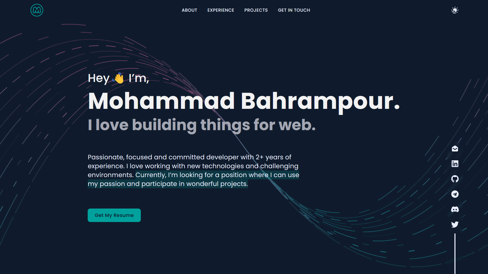

<div align="center">
  
</div>

<h1 align="center">
  Mohammad H. Bahrampour Portfolio
</h1>

<p align="center">
  The first iteration of <a href="https://mhbahrampour.ir/" target="_blank">mhbahrampour.ir</a> built with <a href="https://nextjs.org/" target="_blank">Next.js</a> and hosted with <a href="https://www.netlify.com/" target="_blank">Netlify</a>
</p>

<p align="center">
  <a href="https://app.netlify.com/sites/mhbahrampour/deploys" target="_blank">
    
  </a>
</p>



## 🚨 Forking this repo (please read!)

This website is completely designed and implemented by me, although the design was inspired by Brittany Chiang's portfolio. Feel free to use this project for your personal portfolio but please give me proper credit by linking back to <a href="https:mhbahrampur.ir/" target="_blank">mhbahrampur.ir</a>. Thanks!

## 🛠 Installation & Set Up

1. Install and use the correct version of Node using [NVM](https://github.com/nvm-sh/nvm)

   ```sh
   nvm install
   ```

2. Install dependencies

   ```sh
   npm i
   ```

3. Run tests

   ```sh
   npm run test
   ```
   
4. Start the development server

   ```sh
   npm run dev
   ```

## 🚀 Building and Running for Production

1. Generate a production build

   ```sh
   npm run build
   ```

2. Preview the site as it will appear once deployed

   ```sh
   npm run start
   ```

## 📄 CV

The CV is not a Next.js page: [`cv/`](cv/) is a standalone static project (plain
HTML + Tailwind, with a pre-rendered PDF). `scripts/sync-cv.mjs` copies its build
output into `public/cv/` on every `npm run build` / `npm run dev`, so it is live at
[`/cv/`](https://mhbahrampour.ir/cv/) — and, through the rewrite in
[`netlify.toml`](netlify.toml), at the root of
[`cv.mhbahrampour.ir`](https://cv.mhbahrampour.ir/).

Edit content in `cv/index.html`, rebuild with `bun run build` inside `cv/` (see
[`cv/README.md`](cv/README.md)), then deploy this repo.

## License

[MIT](https://choosealicense.com/licenses/mit/)
